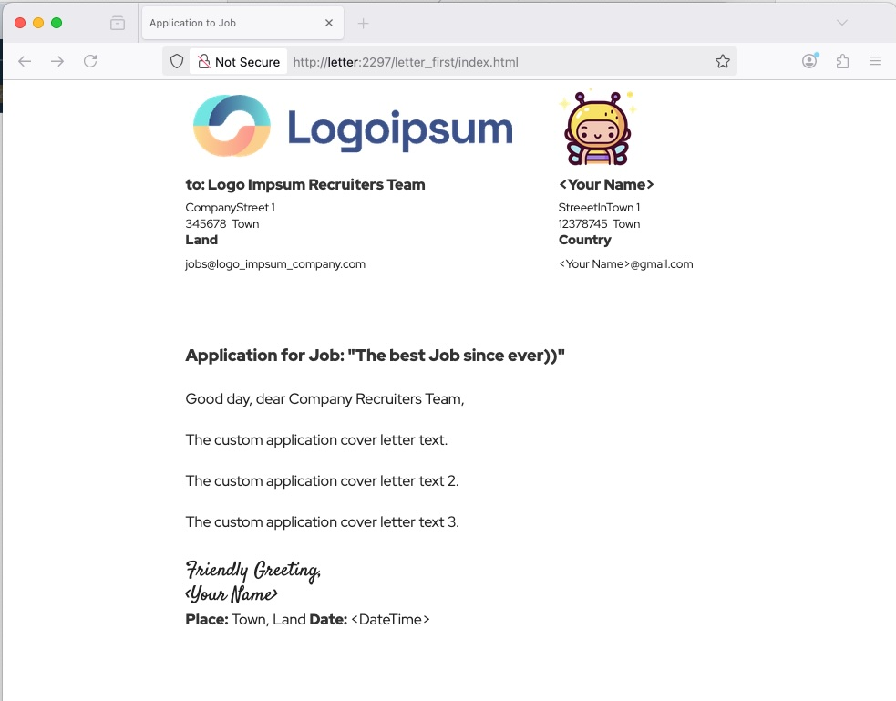
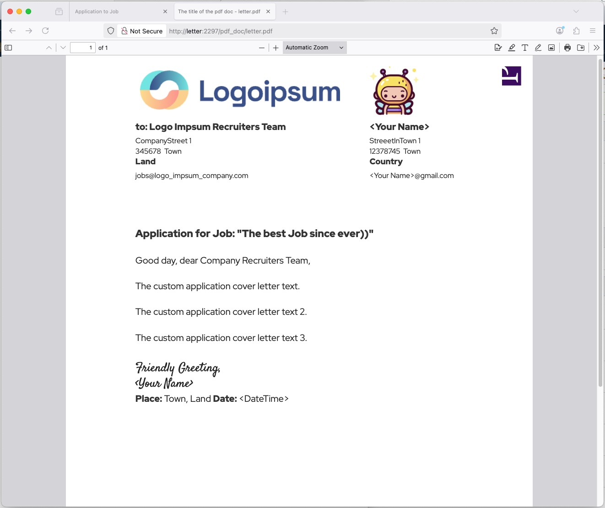
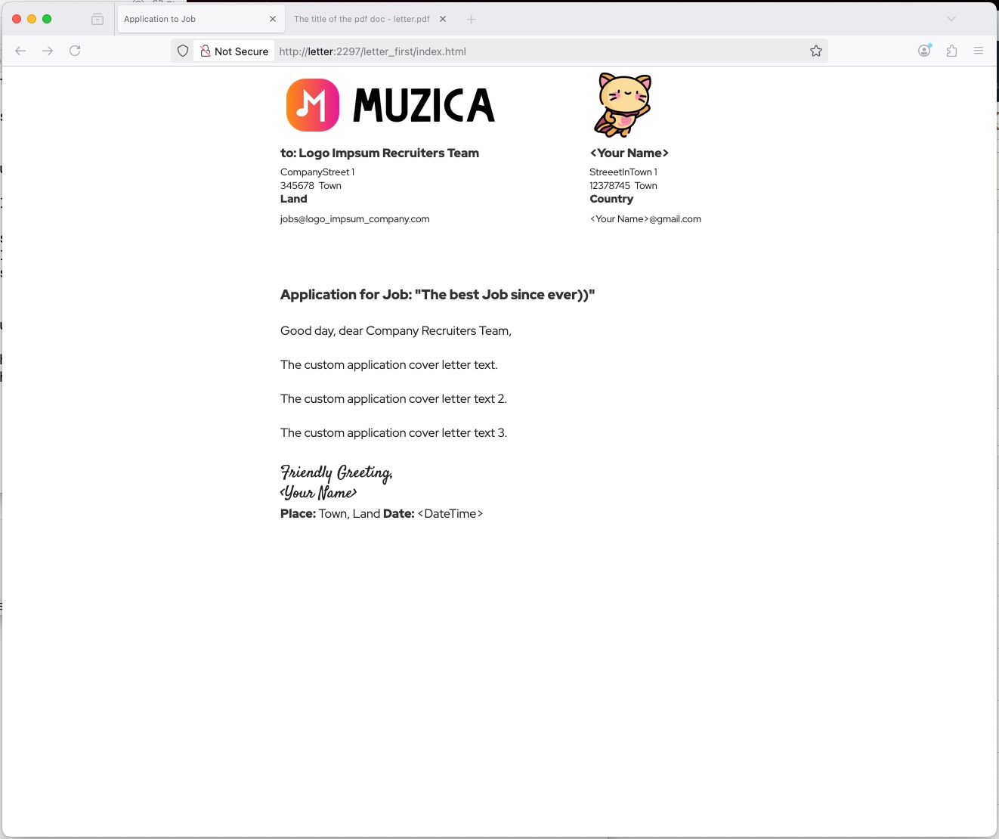
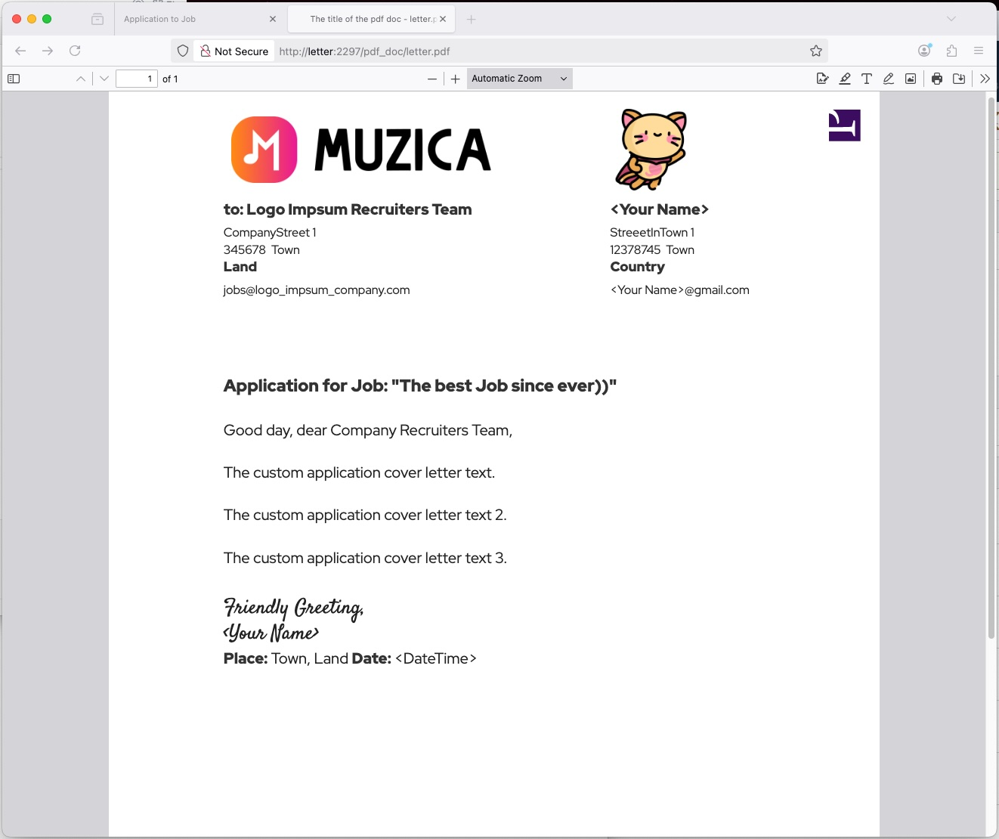

`Docker for a Site` Jaisocx &#8482; &#169;


[HOME Docker for a Site](../../../README.md)


[software_labels preview](../../../README_software_labels.md)


---

  >  🗓  **Updated**:  🌷  Spring 2026

# A4DC

  > **A4DC stands for A4 Electronic Document under Docker by Compose plugin** 
  > 
  > Electronic documents since 90-ieths are for printing or sending via email, render by browsers.
  > 
  > **a4dc** dockerized service works like example of electronic documents by an `.html` page by Software like **Prince**.

  

  1. **LICENSE Required**: for the [https://www.princexml.com/](https://www.princexml.com/) Software

  2. **All ENVs are .gitignored**: `INSTALL_copy_env_examples.sh`

  3. **WITH CAUTION**: `INSTALL_copy_env_examples.sh`. needs backups counter, or overwrites all backed-up real .envs with example_env's.

  4. **USERs' Passwords**: asd

---


**I please, see**

  1. `example_docker-compose.yml` conf,

  2. `docker_compose` folder,

  3. `INSTALL_copy_env_examples.sh` script.

---


  > `start, stop, restart, status, restartus))`










---


### Domains

- dck.basetasks.site
- local.basetasks.site

---


### Links local

  https://local.basetasks.site:8447/
  
  https://local.basetasks.site:8447/favicon.ico
  
  https://local.basetasks.site:8447/Letters/letter_first/
  
  https://local.basetasks.site:8447/Letters/LetterTemplate/
  
  https://local.basetasks.site:8447/jaisocx/
  
  https://local.basetasks.site:8447/cdn_sites/
  

---


## POSTINSTALL after git clone

### POSTINSTALL .envs 

  1. make copies of `example_'s` to => `.env's`, like in `INSTALL_copy_env_examples.sh`, since **all .env's are .gitignored**.

  2. make folder `command/security` with passwords `.owner_pwd` and `.user_pwd` for the produced docs.

  3. Hashed password in `.env's` hardcoded always "asd".

---


### POSTINSTALL Javascript libraries
  ```bash
  
    cd "./workspace/cdn"
    yarn install
    # npm install
  
    cd "./workspace/php_packages"
    composer install
  
  ```
---


### BASH Examples for docker compose
  ```bash
  
    docker network ls
    docker network rm <a_docker_network_id_or_name>
  
    docker compose ps
    docker compose -f "./docker-compose.yml" restart a4dc 

    docker compose -f "./docker-compose.yml" stop a4dc 
    docker compose -f "./docker-compose.yml" rm a4dc --volumes

    docker compose -f "./docker-compose.yml" build a4dc
    docker compose -f "./docker-compose.yml" create a4dc 
    docker compose -f "./docker-compose.yml" start a4dc 
    docker compose -f "./docker-compose.yml" logs a4dc 
    docker compose -f "./docker-compose.yml" exec a4dc bash 
  
  ```

---


Have a nice day, Jaisocx Inc. Software Architect I.P.


